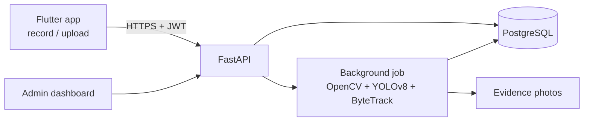

# Helmet Detection

AI-powered helmet compliance checking. Record or upload a short video, and the system finds every person in it, decides **helmet / no helmet**, and returns photo evidence with timestamps. Includes a REST API, an admin dashboard, and a retraining loop driven by reviewer feedback.


> **Mobile app:** [helmet-detection-mobile-app](https://github.com/Samarjitkashyp/helmet-detection-mobile-app) (Flutter, Android). This repository is the backend it talks to.

## Features

- **Video analysis** – YOLOv8 detection with ByteTrack tracking, so each person gets one verdict, not one per frame.
- **Hard-negative aware** – caps, hats, hijabs and turbans are treated as *no helmet*, not as helmets.
- **Evidence** – best frame per person (annotated and raw), confidence, and timestamp.
- **Admin dashboard** – stats, violation review, false-positive marking, user and video management, runtime tuning, CSV export.
- **Retraining loop** – export reviewed frames as a YOLO dataset and fine-tune on Colab.
- **App distribution** – upload the Android APK from the dashboard (Settings → Mobile app) with a live progress bar, then publish it; a "Download app" button appears in the dashboard and users install from the public `/app` page.
- **Production-ready backend** – JWT auth, role-based access, login rate limiting, optional admin IP allow-list, systemd/nginx deployment kit.
- **Quality hints** – warns when a video is too dark or the model is unsure.
- **Live preview model** – the server hands the mobile app an ONNX build of the model (`/app/live-model`) so the app can draw helmet / no-helmet boxes on the camera preview while recording. A retrained model reaches phones without a new app release.

## How it works



1. The client uploads a video (`POST /videos`); the API stores it and returns immediately.
2. A background worker samples every *N*th frame, runs YOLOv8, tracks people across frames, and picks one verdict per person.
3. Results (label, confidence, timestamp, photos) are stored and served to the app and the dashboard.

## Model performance

YOLOv8s fine-tuned at 640 px on ~11.7k training images from seven public datasets (see [Credits](#datasets--credits)). Held-out test images, confidence threshold 0.4:

| Test set | Class | Precision | Recall |
|---|---|---|---|
| Riders / people (300 images) | helmet | 0.93 | 0.93 |
| | no_helmet | 0.95 | 0.84 |
| Caps / hats / hijabs (87 images) | helmet | 0.94 | 0.85 |
| | no_helmet | 0.87 | 0.88 |

mAP@50: **0.92** (riders/people), **0.91** (head coverings). Adding head-covering data raised `no_helmet` recall on caps and hats from 0.21 to 0.88 with no loss on the original set.

> These numbers come from the datasets' own test splits. Accuracy on your cameras will differ: use the review and retraining loop to adapt the model.

Inference runs on CPU at roughly 0.5 s per analysed frame (desktop i3). No GPU is required.

## Tech stack

| Layer | Technology |
|---|---|
| Detection | Ultralytics YOLOv8, ByteTrack, OpenCV, PyTorch (CPU) |
| API | FastAPI, SQLAlchemy 2, Pydantic |
| Database | PostgreSQL (SQLite works for trials) |
| Admin | Jinja2 + HTMX + Chart.js, SQLAdmin |
| Auth | JWT, bcrypt, role-based access |
| Mobile | Flutter (Android), see [helmet-detection-mobile-app](https://github.com/Samarjitkashyp/helmet-detection-mobile-app) |
| Deploy | systemd, nginx, certbot, Cloudflare-friendly |

## Repository structure

```
backend/
  main.py              app entry point
  config.py            environment-driven settings
  api/                 auth and video endpoints
  admin/               dashboard (Jinja2/HTMX) and SQLAdmin data editor
  services/            video processing (YOLO + tracking)
  core/                security, rate limiting, dependencies
  db/                  models and session
  scripts/             create_admin.py, seed_demo.py
  models/best.pt       trained weights
deploy/                nginx, systemd, setup/update/backup scripts, README_DEPLOY.md
training/              dataset merge, Colab notebook, model comparison
```

## Quick start (local)

Requires Python 3.11+ and PostgreSQL (or use a SQLite URL to try it out).

```bash
python -m venv .venv
source .venv/bin/activate            # Windows: .venv\Scripts\activate
pip install torch torchvision --index-url https://download.pytorch.org/whl/cpu
pip install -r backend/requirements.txt

cp backend/.env.example backend/.env    # then edit DATABASE_URL and SECRET_KEY
cd backend
python scripts/create_admin.py          # prompts for admin email and password
uvicorn main:app --reload
```

- Admin dashboard: <http://127.0.0.1:8000/panel>
- Interactive API docs (development only): <http://127.0.0.1:8000/docs>
- Optional demo data: `python scripts/seed_demo.py` (remove with `--clear`)

## API

| Method | Endpoint | Description |
|---|---|---|
| POST | `/auth/register`, `/auth/login` | Create account, get JWT |
| GET | `/auth/me` | Current user |
| POST | `/videos` | Upload a video (returns `202`, processes in background) |
| GET | `/videos` | List your videos with violation counts |
| GET | `/videos/{id}/status` | `processing` / `done` / `failed` |
| GET | `/videos/{id}/results` | Verdict per person, summary, quality warnings |
| GET | `/videos/{id}/detections/{det_id}/image` | Evidence photo |
| DELETE | `/videos/{id}` | Delete video and results |
| GET | `/health` | Liveness check |
| GET | `/app`, `/app/download` | Public install page and APK download (admins upload from the dashboard) |
| GET | `/app/live-model/info`, `/app/live-model` | Version and file of the on-device model (login required) |

## Configuration

Environment variables (`backend/.env`):

| Variable | Default | Purpose |
|---|---|---|
| `DATABASE_URL` | – | SQLAlchemy URL |
| `SECRET_KEY` | – | JWT/session signing (32+ chars in production) |
| `APP_ENV` | `development` | `production` enables hardening (secure cookies, docs off, config checks) |
| `MAX_UPLOAD_MB` | `300` | Upload size limit |
| `KEEP_ORIGINAL_VIDEOS` | `true` | `false` deletes each video after analysis |
| `ADMIN_ALLOWED_IPS` | – | Restrict `/panel` and `/admin` to these IPs |

Detection settings are editable at runtime in the dashboard: confidence threshold, frame skip, minimum person height, minimum frames per person, inference size, maximum video length.

## Training and retraining

```bash
python training/merge_datasets.py            # unify datasets into classes: helmet / no_helmet
python training/compare_models.py best.pt best_v2.pt   # compare two weights on held-out sets
python training/export_onnx.py 416           # build backend/models/live.onnx for the app's live preview
python training/eval_onnx.py                 # check the ONNX model against the PyTorch one
```

`live.onnx` is generated (about 45 MB, git-ignored): run the export after every retraining and redeploy.

Fine-tune with `training/train_colab.ipynb` (free Colab GPU). In production, flag wrong detections in the dashboard and use **Export → Retrain set** to collect corrected frames for the next training round.

## Deployment

A complete kit for Ubuntu/Debian (nginx, systemd, PostgreSQL, HTTPS, nightly backups) is in [`deploy/`](deploy/README_DEPLOY.md).

## Security

JWT auth with role checks, bcrypt password hashing, login rate limiting, secure admin cookies, per-user access to videos and photos, optional admin IP allow-list, and a startup check that refuses weak secrets in production. Videos contain people's faces: restrict access, and consider `KEEP_ORIGINAL_VIDEOS=false`.

## Limitations

- Accuracy drops in darkness, at long range, and with heavily occluded heads.
- Turbans (pagdi) are not yet covered by the training data.
- Counts are **sightings**, not unique people: tracking follows a person while they stay in view, but the same person who leaves and re-enters (for example after a camera cut in an edited clip) is counted again. Tracker tuning (ByteTrack vs BoT-SORT, frame skip, buffer) did not change this; unifying identities across shots would need a person re-identification model.
- Processing is CPU-bound: about one minute of video per several minutes of compute on a small server.
- Schema changes need migrations (Alembic is not set up yet).

## Datasets & credits

Trained on public Roboflow Universe datasets. Thanks to their authors:

| Dataset | License |
|---|---|
| [Helmet and no helmet rider detection](https://universe.roboflow.com/gw-khadatkar-and-sv-wasule/helmet-and-no-helmet-rider-detection) | CC BY 4.0 |
| [Helmet Detection_YOLOv8](https://universe.roboflow.com/learning-evidence/helmet-detection_yolov8) | CC BY 4.0 |
| [Helmet and Number Plate Detection for Motorbike Safety](https://universe.roboflow.com/helmet-and-number-plate-detection-project/helmet-and-number-plate-detection-for-motorbike-safety-iityz) | CC BY 4.0 |
| [Headware detection](https://universe.roboflow.com/atm/headware-detection) | CC BY 4.0 |
| [Cap](https://universe.roboflow.com/ny/cap-ghxtg) | CC BY 4.0 |
| [Hats and masks](https://universe.roboflow.com/krrrz/hats-and-masks) | CC BY 4.0 |
| [Head Accessories](https://universe.roboflow.com/theyearoflinux/head-accessories-9xdyg) | MIT |

Built with [Ultralytics YOLOv8](https://github.com/ultralytics/ultralytics) (AGPL-3.0). Check its license terms before commercial use.

## License

The code in this repository is released under the [MIT License](LICENSE). Third-party components keep their own licenses: Ultralytics YOLOv8 is AGPL-3.0 and the training datasets are listed above. The trained weights are derived from both, so review those terms before commercial use.

## Author

[Samarjitkashyp](https://github.com/Samarjitkashyp)
